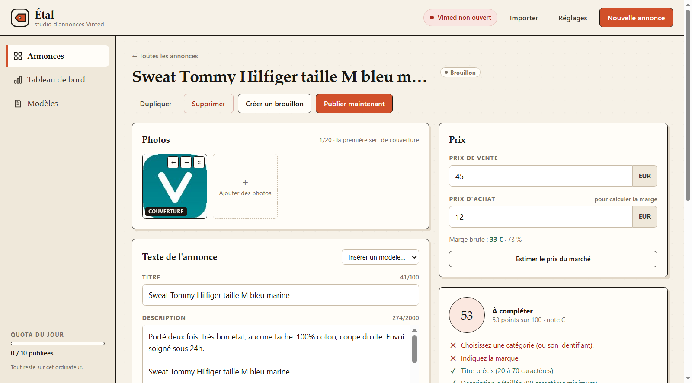
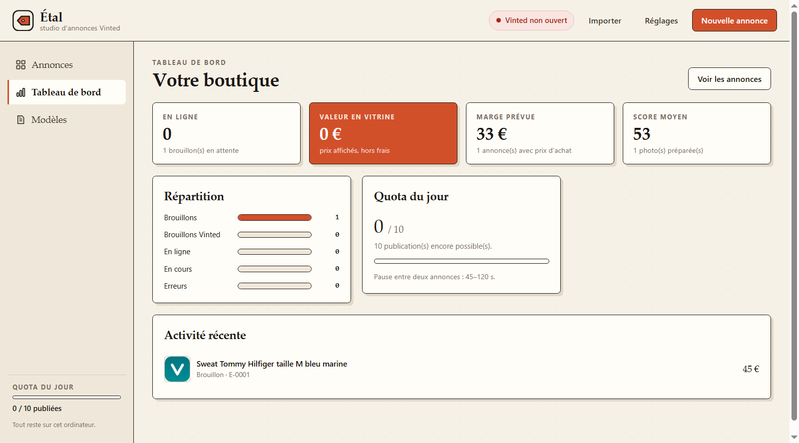

# Étal — studio d'annonces Vinted

Extension Chrome (Manifest V3) pour préparer des annonces **soignées** et les
publier sur votre compte Vinted depuis votre navigateur. Tout reste sur votre
ordinateur : pas de compte, pas de serveur, pas d'abonnement.

> L'atelier avant la vitrine : les autres outils automatisent la republication,
> Étal s'occupe de ce qui fait vendre — les photos, le texte, le prix et la marge.

## Aperçu





## Ce que fait Étal

**Atelier**
- Photos : glisser-déposer, compression automatique, réordonnancement, couverture.
- Texte : titre et description, avec **modèles réutilisables** (`{{marque}}`,
  `{{taille}}`, `{{etat}}`… remplacés automatiquement).
- Détails Vinted : catégorie, marque, taille, état, couleurs, colis — recherchés
  directement dans les listes Vinted.

**Qualité**
- **Score sur 100** de chaque annonce (titre, description, photos, attributs) avec
  les points à corriger.
- **Estimation de prix** à partir d'annonces similaires (fourchette et médiane).
- **Marge** : prix d'achat, prix de vente, marge brute et pourcentage.

**Pilotage**
- **Tableau de bord** : annonces en ligne, valeur en vitrine, marge potentielle,
  score moyen, quota du jour.
- **Références internes** (E-0001, E-0002…) pour retrouver un article.
- **File de publication** : pause aléatoire, plafond quotidien, journal en direct.
- **Import / export CSV** (en-têtes FR ou EN).
- **Mode démo** : simule Vinted, aucune requête réelle.

## Installation

1. Ouvrir `chrome://extensions` (ou `edge://extensions`).
2. Activer le **mode développeur**.
3. **Charger l'extension non empaquetée** → choisir le dossier du dépôt.
4. Cliquer sur l'icône : le studio s'ouvre dans un onglet.

Aucune compilation, aucune dépendance à installer.

## Utilisation

1. Se connecter à Vinted dans le navigateur.
2. Créer une annonce, glisser les photos, remplir le texte.
3. Chercher la catégorie puis la marque (les listes viennent de Vinted) ; la
   taille se charge après la catégorie.
4. Vérifier le score et, si besoin, estimer le prix du marché.
5. **Publier maintenant**, ou **Créer un brouillon** pour valider dans Vinted.

L'ordinateur doit rester allumé avec Chrome ouvert pendant la publication :
c'est votre navigateur qui met en ligne, avec votre session.

## Import CSV

Séparateur `,` ou `;`, première ligne = en-têtes. Colonnes reconnues (FR ou EN) :

| Colonne | Alias | Exemple |
|---|---|---|
| `title` | `titre`, `nom` | Sweat Tommy Hilfiger M |
| `description` | `descriptif` | Très bon état, porté deux fois |
| `price` | `prix` | 25 |
| `catalog_id` | `categorie_id` | 1908 |
| `brand` | `marque` | Tommy Hilfiger |
| `brand_id` | `marque_id` | 94 |
| `size_id` | `taille_id` | 208 |
| `condition_id` | `etat_id` | 2 |
| `color_ids` | `couleurs` | 7\|2 |
| `package_size_id` | `colis_id` | 1 |
| `photos` | `images` | https://…/1.jpg\|https://…/2.jpg |

Les photos par lien demandent une autorisation ponctuelle de téléchargement.
L'identifiant de catégorie et l'identifiant de taille sont les seuls champs que
Vinted ne peut pas deviner.

## Comment ça marche

```
studio (chrome-extension://)
   │  message
   ▼
script de contenu dans un onglet vinted.fr   ← même origine, cookies inclus
   │  fetch + x-csrf-token
   ▼
API interne de Vinted : POST /api/v2/photos
                        POST /api/v2/item_upload/drafts
                        POST /api/v2/item_upload/items
```

Les photos sont compressées (1600 px, JPEG) puis stockées dans IndexedDB. Les
annonces et les modèles vivent dans `chrome.storage.local`.

## Avertissement

Vinted ne propose pas d'API publique de publication et ses conditions
d'utilisation (section 6, octobre 2026) interdisent les outils externes. Les
outils de publication automatique utilisent donc les points d'entrée internes du
site et peuvent entraîner une **suspension temporaire du compte**. Utilisez
Étal pour vos propres articles, à un rythme lent, et privilégiez le mode
brouillon en cas de doute. Vous restez responsable de l'usage de votre compte.

## Développement

```bash
npm run icons   # régénère les icônes PNG
npm test        # tests unitaires (CSV, payload, API, score, modèles, stats)
npm run check   # syntaxe, manifeste, ressources
```

Structure :

- `src/lib/` — modèle d'annonce, CSV, payload Vinted, client API, score, modèles, stats.
- `src/content/bridge.js` — transport HTTP dans l'onglet Vinted.
- `src/studio/` — interface (HTML/CSS/JS sans framework).
- `src/background.js` — ouverture du studio.
